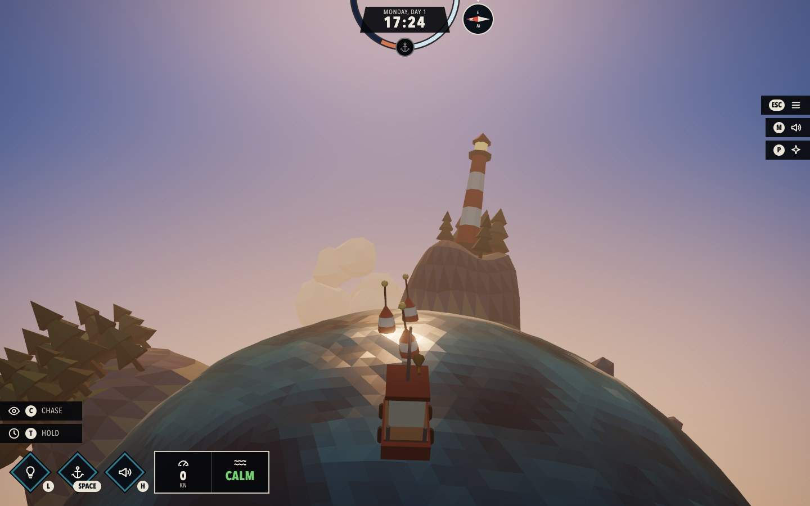
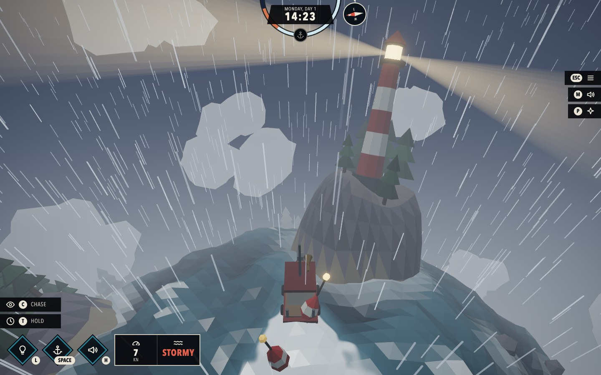
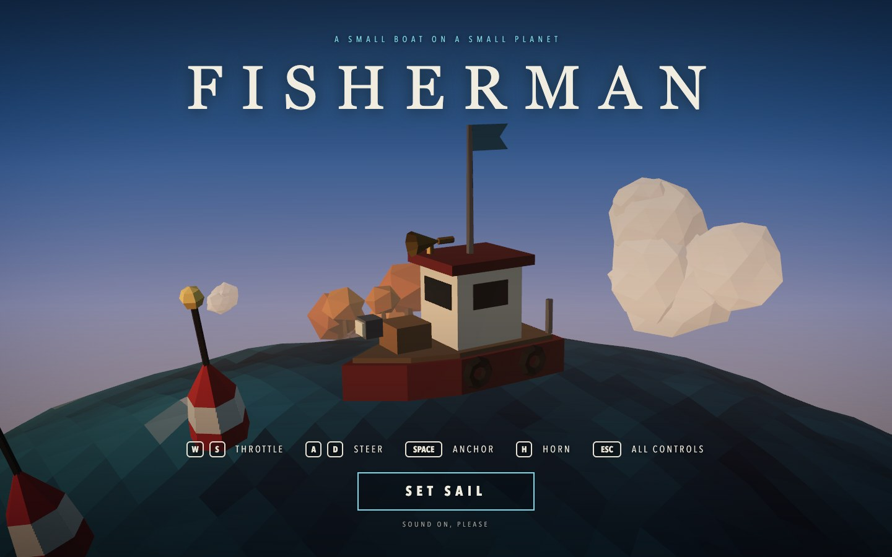

# Fisherman

A tiny Dredge-style ocean planet, rendered in the browser with **Three.js `WebGPURenderer`** and **TSL** (Three.js Shading Language). The sea is a low-poly icosphere whose vertices are displaced and coloured by a 3D simplex noise shader **ported from Shadertoy** (see the credit below). You sail a fishing boat around the planet: it floats on the same waves the GPU draws, leaves a foam wake, bumps into islands, and lights up the night with its lamp. A day/night cycle, weather, a lighthouse and a world of small islands complete the scene.

| | |
| --- | --- |
|  |  |
|  |  |
|  | |

## Shadertoy credit

The noise shader is ported from Shadertoy:

**https://www.shadertoy.com/view/XsX3zB**

Original: "3d simplex noise" by nikat (Nikita Miropolskiy, 2013) on Shadertoy, released under the MIT licence (see [Third-party code](#third-party-code)).

### What was ported

| Shadertoy GLSL | This project (TSL) |
| --- | --- |
| `simplex3d(vec3 p)` | `simplex3d` in [src/tsl/simplexNoise.js](src/tsl/simplexNoise.js) |
| `simplex3d_fractal(vec3 m)` (4 octaves, each rotated by `rot1`/`rot2`/`rot3`) | `simplex3dFractal` in the same file; constants in [src/noiseConstants.js](src/noiseConstants.js) |
| `random3(vec3 c)` | `random3` (see the deviation below) |
| `iTime` as the 3rd noise coordinate | `uniforms.time` added to the z coordinate in [src/tsl/waves.js](src/tsl/waves.js) |
| `mainImage`: `0.5 + 0.5 * value` as a grey level | the signed noise value drives wave height (vertex stage) and the colour ramp (fragment stage) in [src/tsl/waterMaterial.js](src/tsl/waterMaterial.js) |

**One deliberate change:** the original `random3` hashes with `sin(...) * 4096.0`, which gives different results on a float32 GPU and in float64 JavaScript. The boat physics needs to evaluate the *same* waves on the CPU, so the hash was replaced with an integer PCG hash that is bit-identical on both sides. The rest of the algorithm is a line-by-line translation, with the GLSL kept as comments next to each TSL statement.

### How the translation works

GLSL becomes TSL by turning the language into method calls on node objects, which three.js compiles to WGSL. For example:

```glsl
vec3 s = floor(p + dot(p, vec3(F3)));          // GLSL
```
```js
const s = floor(p.add(dot(p, vec3(F3)))).toVar()   // TSL
```

- **Functions** become `Fn(([p]) => { ... })`. Built-ins keep their names (`floor`, `dot`, `step`, `max`, `mix`, `smoothstep`) and are imported from `three/tsl`.
- **Operators** become methods: `a + b` is `a.add(b)`, `a * b` is `a.mul(b)`, `1.0 - x` is `float(1).sub(x)`. JavaScript cannot overload `+`, and `node + 0.1` would silently become a string.
- **Swizzles** work as they are: `x.yzx`, `e.zxy`.
- **Local variables** that are reused are marked with `.toVar()`, which makes TSL declare a real variable in the shader instead of repeating the expression.
- **`iTime`** becomes a uniform node written from JavaScript every frame (`uniforms.time`) rather than TSL's built-in `time`, so the boat physics reads exactly the same clock.
- **`mainImage` and the fragment position** become material nodes: the noise displaces `positionNode` (starting from `positionLocal`, the vertex's position on the sphere) and drives `colorNode`, using `mix` and `smoothstep` for the dark-blue-to-white ramp.
- **Matrices** such as `m * rot1` (a row vector times a column-major `mat3`) are written out as one `dot` per column, which is what GLSL does.
- **Integer hashing** uses TSL's unsigned types (`uvec3`, `.bitXor`, `.shiftRight`), which compile to `vec3<u32>` operations in WGSL.

### CPU copy and parity test

The boat has to float on the waves the GPU draws, so the same noise also exists in JavaScript ([src/physics/](src/physics/)). Open the app with `?parity` (e.g. `http://localhost:5173/?parity`) to run the TSL functions in a compute shader, read the results back and compare them with the JS version: the hash matches bit for bit and the wave height differs by less than 0.00003 world units.

## Day and night

A full day lasts 3.5 minutes. The sun and moon circle the planet, so one side is always dark; the sky colour, haze, light tint and water palette follow the sun's height at the boat, which means sailing around the planet changes your local time of day. The sky is a TSL material computed from the view direction (gradient, sun, moon, procedural stars), see [src/tsl/skyMaterial.js](src/tsl/skyMaterial.js).

## Weather and wake

The weather cycles automatically between clear, overcast, storm and clearing (or force it with `1`-`3`). Three numbers (storm, cloud cover, rain) drive the wave height and foam in the water shader, the sky and light colours, the low-poly clouds and the rain. The rain is instanced geometry whose positions are computed entirely in the vertex shader ([src/tsl/rainMaterial.js](src/tsl/rainMaterial.js)): every streak falls towards the planet centre.

The boat leaves a wake. Its last 64 stern positions are sent to the water shader as a uniform array. The shader draws an expanding foam ring around each one (together they form the V of the wake), a churned strip of propeller wash behind the stern, and a splash at the bow ([src/tsl/wake.js](src/tsl/wake.js)). So that it stands out from the wave foam, the smooth wake value is broken up with the ported simplex noise at pixel resolution and cut off sharply ([src/tsl/waterMaterial.js](src/tsl/waterMaterial.js)): lacy, bright white foam with a lighter, aerated halo, instead of flat coloured triangles. The faster you sail, the stronger the foam, and an anchored boat leaves none.

## The world

Ten low-poly islands with pines, autumn trees and rocks, a striped lighthouse whose beam sweeps the sea at night and in storms, buoys that float on the same waves as the boat and blink in the dark, and rocks in open water. The layout is seeded, so the world is the same every time. You cannot sail through land: the boat slides along the shore and loses speed ("BUMP!"). Where the water meets an island the water shader draws surf, computed from the island positions passed in as a uniform array ([src/tsl/shore.js](src/tsl/shore.js)).

## Boat physics

The boat is a small rigid body sliding over the sea, not a point that snaps to the waves ([src/physics/](src/physics/)):

- **Engine and keel** ([boatMotion.js](src/physics/boatMotion.js)): the engine pulls the velocity along the hull slowly (it is heavy); the keel resists sideways slip but not instantly, so the boat drifts a little in a turn. The helm sets a target turn rate that the boat follows with inertia, so it keeps turning for a moment after you let go.
- **Weight** ([boatDynamics.js](src/physics/boatDynamics.js)): the visible hull follows the wave surface through two damped springs (up and down, and roll and pitch). Short ripples are ignored, the long swell lifts and rolls it slowly, and it rocks once before settling. It also leans outward in turns and the bow lifts when it accelerates. Measured over a minute at speed, the vertical jerkiness drops by 15x compared with a weightless boat.
- **Collisions** ([collision.js](src/physics/collision.js), [islandShape.js](src/physics/islandShape.js)): the terrain mesh and the collision use the same island definition, so the boat hits the *real* coastline. A hit removes the velocity into the shore (with a little bounce), friction slows the scrape, and the point of the hull that touched is pushed away, so a glancing bow hit swings the bow around. Overlap is corrected softly a little each frame, so it never jumps.

`npm run check` runs 19 checks of this (no browser needed): the boat stays on the sphere, accelerates gradually, drifts, turns with inertia, never sinks into a shoreline, never jumps, and the weight calms the motion.

## Sound

All sound is generated in the browser with the Web Audio API, so there are no sound files ([src/audio/](src/audio/)). Browsers only allow sound after a click, so it starts with the "Set sail" button.

- **Continuous layers follow the game, every frame.** Engine: silent at a standstill, fading in as you pick up speed, with rising pitch, chug rate and brightness. Hull wash: silent at a standstill, growing with speed. Sea: always a gentle swell, louder in storms. Rain: follows the rain level. In planet view they are muffled, and when paused they are silent. Changes glide (`setTargetAtTime`), so there are no clicks.
- **One-shots** for the lamp switch, the anchor (chain rattle and a splash, or a creak when it comes up), hitting a shore (thump and a groan, louder for harder hits) and the horn (two low sawtooth notes a fifth apart, with vibrato and reverb, sounding as long as you hold `H`).
- **Music** is a slow generative piece (four chords in D minor, soft plucks from the pentatonic scale). To use your own track instead, put it at `public/audio/music.mp3` and it replaces the generated music automatically.
- Volumes for music and effects are on the pause screen and are remembered; `M` mutes. In the dev build, `__game.audio.levels()` shows the level of every layer, which is how the mix was checked without listening.

## Post-processing

The scene is rendered once into a texture, then a TSL node graph adds bloom (only really bright HDR pixels glow: the sun, the lamps, the lantern) and a soft vignette, followed by tone mapping ([src/post.js](src/post.js)). Press `P` to compare with the plain render.

## Assignment requirements

- Three.js with `WebGPURenderer` (no `WebGLRenderer`; the app shows an error instead of falling back to WebGL2).
- Shader written as TSL node materials (`MeshStandardNodeMaterial` with `positionNode` / `colorNode`), no `ShaderMaterial` or `RawShaderMaterial`.
- The original Shadertoy URL is credited at the top of this file (and in the header of the shader files).
- The shader responds to user input: the weather keys change the wave amplitude and foam in real time, and the boat's wake is drawn into the water by the shader from where and how fast you sail.

## Start screen

The game opens on a close-up of the boat with the title above it, five key hints and a "Set sail" button. Behind the glass the world is already running (waves, clouds, the boat bobbing), but the clock, the weather and the boat stand still. Pressing the button starts the music and swings the camera round the port side from the front of the boat to behind it (about 3 seconds, eased, with the lens widening from 38 to 55 degrees), and the interface fades in as the camera arrives and the game begins. The camera poses are in `INTRO` in [src/config.js](src/config.js) and the swing is in [src/camera/introCamera.js](src/camera/introCamera.js).

## Controls

The start screen shows only the five essentials; `Esc` pauses (so does switching to another window) and opens the full list, with the volume sliders.

| Input | Action |
| --- | --- |
| `W` / `S` (or arrows) | Throttle / reverse |
| `A` / `D` | Steer to port / starboard (needs speed) |
| `Space` or `X` | Drop / raise the anchor (stops the boat) |
| `H` (hold) | Horn |
| `L` | Bow lamp on / off (spotlight on the water, glowing windows, light cone) |
| Hold `T` | Fast-forward the day/night cycle |
| `C` | Switch between the chase camera and a free orbit around the planet |
| Mouse wheel | Zoom the chase camera (drag to orbit in planet view) |
| `1` / `2` / `3` | Force calm / breezy / storm weather |
| `4` | Automatic weather again (clear, overcast, storm, clearing, repeat) |
| `P` | Bloom and vignette on / off |
| `M` | Mute / unmute all sound (works on every screen; the start and pause screens also have a Sound button, and the setting is remembered) |
| `Esc` | Pause / resume |

Letter keys match the letter printed on the key, so the controls work on QWERTY and AZERTY keyboards alike (on AZERTY both the keys labelled WASD and the ones in the WASD position steer); Cmd/Ctrl/Alt shortcuts are ignored.

The interface follows Dredge's: a ring that turns with the time of day (the anchor marker is "now" and lights up when the anchor is down), the day and clock, a compass whose dial turns while the marker at the top is the bow, diamond buttons for the lamp, anchor and horn with their keys, a stat box with speed (in knots) and sea state, and strips for the camera, time, menu, sound and effects. Short messages ("Lamp on", "Anchor down", "Bump!") appear under the dial.

## Run it

Needs a WebGPU browser (recent Chrome or Edge, Safari 26). It was developed and tested in Chrome; I have not been able to try Safari.

```bash
npm install
npm run dev      # http://localhost:5173
npm run build    # production build in dist/ (relative paths, so it works from any folder)
npm run preview  # serve the production build locally
npm run check    # physics checks (Node only, a few seconds)
```

## Project layout

```
src/
  main.js            renderer, scene, camera, loop
  config.js          shared constants (planet, waves, palette)
  uniforms.js        uniform nodes shared by JS and TSL
  interaction.js     keyboard input
  hud.js             the in-game interface (day ring, compass, tools, stats)
  menu.js            start screen and pause screen
  audio/             synthesised sound effects, engine / water / rain layers, music
  camera/            title close-up and swing, chase camera, the camera rig
  scene/             planet mesh, lighting, boat model, sky dome, clouds, rain, islands, lighthouse, buoys
  world/             game clock, day/night atmosphere, weather, wake trail, world layout
  tsl/               simplexNoise (the port), waves, waterMaterial, wake, shore, lightCone, skyMaterial, rainMaterial
  physics/           JavaScript copy of the noise and waves, boat motion, weight, island shapes, collisions
  noiseConstants.js  constants of the Shadertoy noise shared by TSL and JS
  post.js            bloom + vignette (RenderPipeline)
  debug/             GPU-vs-CPU parity test (?parity)
tests/             physics checks (npm run check)
```

## Third-party code

The simplex noise in [src/tsl/simplexNoise.js](src/tsl/simplexNoise.js) and [src/physics/simplexNoise.js](src/physics/simplexNoise.js) is derived from https://www.shadertoy.com/view/XsX3zB, whose header states "The MIT License, Copyright © 2013 Nikita Miropolskiy". Standard MIT text:

> Copyright © 2013 Nikita Miropolskiy
>
> Permission is hereby granted, free of charge, to any person obtaining a copy of this software and associated documentation files (the "Software"), to deal in the Software without restriction, including without limitation the rights to use, copy, modify, merge, publish, distribute, sublicense, and/or sell copies of the Software, and to permit persons to whom the Software is furnished to do so, subject to the following conditions:
>
> The above copyright notice and this permission notice shall be included in all copies or substantial portions of the Software.
>
> THE SOFTWARE IS PROVIDED "AS IS", WITHOUT WARRANTY OF ANY KIND, EXPRESS OR IMPLIED, INCLUDING BUT NOT LIMITED TO THE WARRANTIES OF MERCHANTABILITY, FITNESS FOR A PARTICULAR PURPOSE AND NONINFRINGEMENT. IN NO EVENT SHALL THE AUTHORS OR COPYRIGHT HOLDERS BE LIABLE FOR ANY CLAIM, DAMAGES OR OTHER LIABILITY, WHETHER IN AN ACTION OF CONTRACT, TORT OR OTHERWISE, ARISING FROM, OUT OF OR IN CONNECTION WITH THE SOFTWARE OR THE USE OR OTHER DEALINGS IN THE SOFTWARE.
