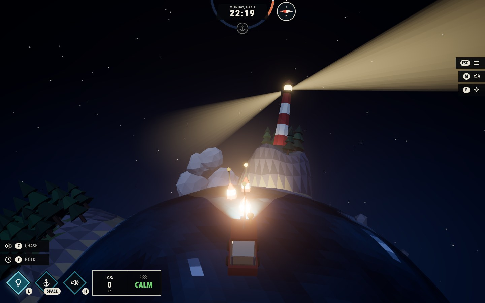
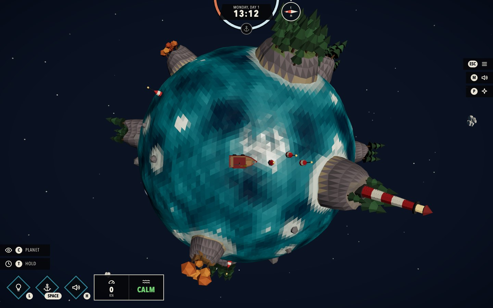

# Wake

A tiny Dredge-style ocean planet, rendered in the browser with **Three.js `WebGPURenderer`** and **TSL** (Three.js Shading Language). The sea is a low-poly icosphere whose vertices are displaced and coloured by a 3D simplex noise shader **ported from Shadertoy** (see the credit below). You sail a fishing boat around the planet: it floats on the same waves the GPU draws, leaves a foam wake, bumps into islands, and lights up the night with its lamp. A day/night cycle, weather, a lighthouse and a world of small islands complete the scene.

| | |
| --- | --- |
|  |  |
|  |  |
|  | |

## Shadertoy credit

The noise shader is ported from Shadertoy:

**https://www.shadertoy.com/view/XsX3zB**

Original: "3d simplex noise" by nikat (Nikita Miropolskiy, 2013) on Shadertoy, released under the MIT licence (see [Third-party code](#third-party-code)).

### What was ported

| Shadertoy GLSL | This project (TSL) |
| --- | --- |
| `simplex3d(vec3 p)` | `simplex3d` in [src/tsl/simplexNoise.js](src/tsl/simplexNoise.js) |
| `simplex3d_fractal(vec3 m)` (4 octaves, each rotated by `rot1`/`rot2`/`rot3`) | `simplex3dFractal` in the same file; constants in [src/noiseConstants.js](src/noiseConstants.js) |
| `random3(vec3 c)` | `random3` (see the deviation below) |
| `iTime` as the 3rd noise coordinate | `uniforms.time` added to the z coordinate in [src/tsl/waves.js](src/tsl/waves.js) |
| `mainImage`: `0.5 + 0.5 * value` as a grey level | the signed noise value drives wave height (vertex stage) and the colour ramp (fragment stage) in [src/tsl/waterMaterial.js](src/tsl/waterMaterial.js) |

**One deliberate change:** the original `random3` hashes with `sin(...) * 4096.0`, which gives different results on a float32 GPU and in float64 JavaScript. The boat physics needs to evaluate the *same* waves on the CPU, so the hash was replaced with an integer PCG hash that is bit-identical on both sides. The rest of the algorithm is a line-by-line translation, with the GLSL kept as comments next to each TSL statement.

### How the translation works

GLSL becomes TSL by turning the language into method calls on node objects, which three.js compiles to WGSL. For example:

```glsl
vec3 s = floor(p + dot(p, vec3(F3)));          // GLSL
```
```js
const s = floor(p.add(dot(p, vec3(F3)))).toVar()   // TSL
```

- **Functions** become `Fn(([p]) => { ... })`. Built-ins keep their names (`floor`, `dot`, `step`, `max`, `mix`, `smoothstep`) and are imported from `three/tsl`.
- **Operators** become methods: `a + b` is `a.add(b)`, `a * b` is `a.mul(b)`, `1.0 - x` is `float(1).sub(x)`. JavaScript cannot overload `+`, and `node + 0.1` would silently become a string.
- **Swizzles** work as they are: `x.yzx`, `e.zxy`.
- **Local variables** that are reused are marked with `.toVar()`, which makes TSL declare a real variable in the shader instead of repeating the expression.
- **`iTime`** becomes a uniform node written from JavaScript every frame (`uniforms.time`) rather than TSL's built-in `time`, so the boat physics reads exactly the same clock.
- **`mainImage` and the fragment position** become material nodes: the noise displaces `positionNode` (starting from `positionLocal`, the vertex's position on the sphere) and drives `colorNode`, using `mix` and `smoothstep` for the dark-blue-to-white ramp.
- **Matrices** such as `m * rot1` (a row vector times a column-major `mat3`) are written out as one `dot` per column, which is what GLSL does.
- **Integer hashing** uses TSL's unsigned types (`uvec3`, `.bitXor`, `.shiftRight`), which compile to `vec3<u32>` operations in WGSL.

### CPU copy and parity test

The boat has to float on the waves the GPU draws, so the same noise also exists in JavaScript ([src/physics/](src/physics/)). Open the app with `?parity` (e.g. `http://localhost:5173/?parity`) to run the TSL functions in a compute shader, read the results back and compare them with the JS version: the hash matches bit for bit and the wave height differs by less than 0.00003 world units.

## Day and night

A full day lasts 3.5 minutes, with this schedule: morning twilight 04:00-06:00, full day 06:00-18:00, evening twilight 18:00-20:00, night 20:00-04:00 (`DAY.hours` in `src/config.js`; the ring at the top of the HUD uses the same hours). The game starts at 18:30. The sun and moon circle the planet, so one side is always dark; the sky colour, haze, light tint and water palette follow the sun's height at the boat. The sky is attached to the player, not to the planet: because the planet is tiny, a sun fixed in space would put you through sunset just by sailing round it. Instead the sun is carried along with the boat (see `skyFrame` in [src/world/atmosphere.js](src/world/atmosphere.js)), so the time on the clock is the time everywhere, and in planet view you see the day and night sides slide round as you sail. The sky is a TSL material computed from the view direction (gradient, sun, moon, procedural stars), see [src/tsl/skyMaterial.js](src/tsl/skyMaterial.js).

## Weather and wake

The weather cycles automatically between clear, overcast, storm and clearing (or force it with `1`-`3`). Three numbers (storm, cloud cover, rain) drive the wave height and foam in the water shader, the sky and light colours, the low-poly clouds and the rain. The rain is instanced geometry whose positions are computed entirely in the vertex shader ([src/tsl/rainMaterial.js](src/tsl/rainMaterial.js)): every streak falls towards the planet centre.

In a full storm (heavy rain and high seas) there is **lightning** ([src/world/lightning.js](src/world/lightning.js)): every 5 to 14 seconds a strike makes two or three quick flickers that turn the sky, haze and clouds blue-white and light the boat and the sea from above, followed a moment later by thunder (the delay is the distance), synthesised in [src/audio/audio.js](src/audio/audio.js). If there is a `public/audio/thunder.mp3`, it also plays in a quiet loop for as long as the storm lasts (fading in and out with it; `THUNDER_VOLUME` in `audio.js`). Tuning: `LIGHTNING` in [src/config.js](src/config.js).

The boat leaves a wake, and it is the **fourth Shadertoy shader** in the project, ported to TSL: a physically motivated wake ([src/tsl/wakeWaves.js](src/tsl/wakeWaves.js), see [Third-party code](#third-party-code); the GLSL is kept as comments). It does not draw a V: it adds up the waves the boat emitted at every point of its past path, each travelling by the deep-water dispersion relation (long waves run faster than short ones), and the V-shaped Kelvin wake with its bow waves appears by itself. Here the "past path" is the boat's last 64 stern positions (every 0.1 s), sent to the water shader as a uniform array; the sum is computed per pixel, bends with the boat when you turn and is as strong as you are fast (an anchored boat leaves none). The result is used three ways: it tilts the lighting normal (screen-space bump mapping, shared with the raindrops, so the waves catch the sun, moon and lamp), lightens crests and darkens troughs, and the highest crests near the boat break into white lace. On top of that the older foam layers remain: a churned strip of propeller wash behind the stern and a splash at the bow ([src/tsl/wake.js](src/tsl/wake.js)), broken up with the ported simplex noise at pixel resolution and cut off sharply ([src/tsl/waterMaterial.js](src/tsl/waterMaterial.js)). Tune it in `WAKE.waves` in [src/config.js](src/config.js) (`gravity`, `peak`, `width`, `gain`).

## Dolphins

Every 7 to 16 seconds (in calm to moderate weather, also in planet view) a dolphin leaps out of the sea near the boat, arcs across its path and dives back in, with a ring of foam and a splash sound where it enters and leaves the water ([src/scene/dolphin.js](src/scene/dolphin.js), `DOLPHIN` in [src/config.js](src/config.js)). The leap is a parabola over the curved sea that rides on the wave surface and is placed in open water only. There is no skeleton: the model is bent along its body in the vertex shader (a TSL tail beat), so any static mesh works. (Switched off for now: `DOLPHIN.enabled` in the config.) Put your own model at `public/models/dolphin.glb` (see `public/models/README.txt`); without it a low-poly dolphin built in code is used.

## The world

Seven low-poly islands (after the ocean below takes its share) with pines, autumn trees and rocks, a striped lighthouse whose beam sweeps the sea at night and in storms, buoys that float on the same waves as the boat, blink in the dark, and can be knocked over (they right themselves again; you sail straight through), and rocks in open water. The layout is seeded, so the world is the same every time. One big circle of open ocean, covering 22% of the planet and starting about 6 units behind where you begin, has no islands, rocks or buoys at all (`WORLD.ocean` in `src/config.js`); everything outside it is exactly as it would be without it. You cannot sail through land: the boat slides along the shore and loses speed ("BUMP!"). Where the water meets an island the water shader draws surf, computed from the island positions passed in as a uniform array ([src/tsl/shore.js](src/tsl/shore.js)).

## Boat physics

The boat is a small rigid body sliding over the sea, not a point that snaps to the waves ([src/physics/](src/physics/)):

- **Engine and keel** ([boatMotion.js](src/physics/boatMotion.js)): the engine pulls the velocity along the hull slowly (it is heavy); the keel resists sideways slip but not instantly, so the boat drifts a little in a turn. The helm sets a target turn rate that the boat follows with inertia, so it keeps turning for a moment after you let go.
- **Weight** ([boatDynamics.js](src/physics/boatDynamics.js)): the visible hull follows the wave surface through two damped springs (up and down, and roll and pitch). Short ripples are ignored, the long swell lifts and rolls it slowly, and it rocks once before settling. It also leans outward in turns and the bow lifts when it accelerates. Measured over a minute at speed, the vertical jerkiness drops by 15x compared with a weightless boat.
- **Collisions** ([collision.js](src/physics/collision.js), [islandShape.js](src/physics/islandShape.js)): the terrain mesh and the collision use the same island definition, so the boat hits the *real* coastline. A hit removes the velocity into the shore (with a little bounce), friction slows the scrape, and the point of the hull that touched is pushed away, so a glancing bow hit swings the bow around. Overlap is corrected softly a little each frame, so it never jumps.

`npm run check` runs 19 checks of this (no browser needed): the boat stays on the sphere, accelerates gradually, drifts, turns with inertia, never sinks into a shoreline, never jumps, and the weight calms the motion.

## Sound

All sound is generated in the browser with the Web Audio API, so there are no sound files ([src/audio/](src/audio/)). Browsers only allow sound after a click, so it starts with the "Set sail" button.

- **Continuous layers follow the game, every frame.** Engine: silent at a standstill, fading in as you pick up speed, with rising pitch, chug rate and brightness. The hull-wash and sea layers are switched off (`USE_WATER_SOUND` in `audio.js`, the code is kept; the music already has water in it). Rain: follows the rain level. In planet view they are muffled, and when paused they are silent. Changes glide (`setTargetAtTime`), so there are no clicks.
- **One-shots** for the lamp switch, the anchor (chain rattle and a splash, or a creak when it comes up), hitting a shore (thump and a groan, louder for harder hits) and the horn (two low sawtooth notes a fifth apart, with vibrato and reverb, sounding as long as you hold `H`).
- **Music** is a slow generative piece (four chords in D minor, soft plucks from the pentatonic scale). To use your own track instead, put it at `public/audio/music.mp3` and it replaces the generated music automatically.
- Volumes for music and effects are on the pause screen and are remembered; `M` mutes. In the dev build, `__game.audio.levels()` shows the level of every layer, which is how the mix was checked without listening.

## The bow lamp on a curved world

From a lamp 0.3 above the water, the horizon of this tiny planet is only about 1.7 units away: the sea curves away beneath any straight beam, so a spotlight alone can only light the water near the boat (and objects that stand up, like buoys and islands). So the lamp has two parts: the real `SpotLight` for objects and the hull, and a pool of light drawn by the water shader *along the curved surface*, reaching about 7.5 units ahead of the bow ([src/tsl/lampPool.js](src/tsl/lampPool.js)). It is strong at night and faint by day.

## Fish

Schools of fish swim under the sea, and you see them as soft dark **shadows on the water**, faded ellipses pointing the way each fish swims: 120 small fish in 6 schools, with three schools close to where you start. They swim away from the boat when you get close. This is the **third Shadertoy shader** in the project, ported to TSL: the boids simulation of "[SH17C] Schooling" by P_Malin, in [src/tsl/boids.js](src/tsl/boids.js), with the GLSL kept as comments.

The idea comes from Craig Reynolds' 1987 paper: every fish only knows its position, its velocity and the fish near it, and three rules steer it. **Separation** pushes it away from fish that are too close, **cohesion** pulls it towards the middle of its neighbours and **alignment** turns it the way they are swimming, plus a little random wandering and avoidance of land. There is no leader, yet schools form by themselves, split and merge. The simulation runs in a compute shader: the state is in storage buffers (double buffered, where the Shadertoy keeps it in textures), and the water shader reads their positions straight from those buffers, so the CPU never touches them.

What changed to fit this project:
- **A sphere instead of a 10 x 10 wrap-around square.** Fish live on the planet, moving in the tangent plane, and lengths and speeds are scaled to it (`FISH.lengthScale`, `FISH.frameRate`).
- **Real obstacles.** The three rocks and the walls of the original are replaced by the actual islands and rocks of the world, so the schools swim round them.
- **Added:** the fish swim away from the boat (more so when you go fast), and they start in schools, since the original relies on a dense crowd. The slider defaults of the original were in code that was cut off when it was pasted, so each weight is assumed to be 1 (`FISH`).
- **Drawn as shadows** ([src/tsl/fishShadows.js](src/tsl/fishShadows.js)): not as separate objects but painted into the water's own colour. For every point of the sea the shader loops over the fish, puts the point into each fish's frame (along and across the direction it swims) and darkens it by a soft ellipse. So a shadow always lies exactly on the surface and follows the waves, in any weather. Deeper fish give fainter and smaller shadows, and every school has its own size. The idea of showing them as shadows, and the look, are my own; the original only draws dots.

`?fish` (e.g. `http://localhost:5173/?fish`) reads the fish back from the GPU and checks them for a minute: no bad numbers, still on the sphere, speeds within the original's limits, none inside land, and the schools holding together. Size, darkness and count are in `FISH` in [src/config.js](src/config.js).

## Fishing

Six patches of **bubbling water** are scattered over the sea (one close to where you start, a couple in the big empty ocean). Each is a faceted patch of foam painted into the water by the water shader ([src/tsl/spotFoam.js](src/tsl/spotFoam.js): a disc with rings lapping outwards, per triangle like the shore foam, so it also shows from planet view) with bubbles rising out of it. The bubbles are one instanced mesh whose positions are worked out entirely in the vertex shader from the instance index and the clock ([src/tsl/fishingBubbles.js](src/tsl/fishingBubbles.js)); JavaScript only writes six small records per frame. A message says when fish are biting; **drop the anchor within about 0.45 units of a patch** and the fishing minigame opens ([src/fishing/](src/fishing/)):

- **Hold `Space`** (or the on-screen button, with a mouse or a finger) to reel in. **Progress** (green) rises slowly and **Tension** (red) rises fast, so you reel in bursts and let go between them. Tension at 100% snaps the line; progress at 100% lands the fish. Now and then the fish pulls (the little fish on the panel twitches first): let go. `Esc` lets the fish go.
- A catch is one of **16 species** in four rarities (common 60%, uncommon 27%, rare 10%, legendary 3%), each with a weight range, a description and an inline SVG picture ([src/fishing/fishDatabase.js](src/fishing/fishDatabase.js)). The fish is rolled when the fight starts but hidden until you land it, and rarer fish pull harder.
- The **logbook** (`B`, or the book button) shows every species as a silhouette until you have caught one, then its name, picture, how many you landed, your heaviest and what is known about it. It is saved in the browser.
- A patch you have fished out stays empty, its bubbles dying away, until midnight on the game clock. The world keeps running during the fight (the clock, the weather); only the controls are locked.

The rules of the fight are plain functions with no DOM ([src/fishing/fishingMinigame.js](src/fishing/fishingMinigame.js)), checked in `tests/fishing.check.mjs` (`npm run check`), including that a player who reacts a third of a second late still wins every rarity in 11 to 21 seconds and one who never lets go always loses. All the numbers are in `FISHING` in [src/config.js](src/config.js).

## Raindrops on the water

While it rains, drops land on the sea and spread out as rings of ripples. This is the **second Shadertoy shader** in the project, ported to TSL: https://www.shadertoy.com/view/ldjyWw (a fork of https://www.shadertoy.com/view/4ldSRj, see [Third-party code](#third-party-code)), in [src/tsl/raindrops.js](src/tsl/raindrops.js), with the GLSL kept as comments next to each statement.

How it works: the sea is cut into a grid of cells; every cell has a drop that lands at a random spot on its own timer and sends out a few concentric rings that spread and fade, and when they have faded a new drop lands somewhere else. The ripples of the 3 x 3 neighbouring cells are combined into a height field. The original shows the slope of that field as a colour on a flat plane. Here the slope tilts the water's lighting normal (screen-space bump mapping), so the ripples catch the sun, moon and lamp, and it lightens the water a little on them.

What changed to fit this project:
- **A sphere instead of a plane.** The sea is covered by three flat maps (one per axis, like a cube) and each pixel uses the one it is nearest to. Ripples are faded out right on the seams, and with distance (they would be thinner than a pixel and shimmer).
- **Rain level.** The original always rains. The unused `y` channel of its grid hash now switches cells on and off, so a drizzle has a few drops and a downpour many; when it is dry nothing is computed at all.
- **Fades with the rain.** The ripples' strength also follows the rain level (`DROPS.fade`), so they die away together with the rain streaks when a storm ends (about 9 seconds), instead of lingering while the level eases down.
- **No plane term.** The constant `pl` in `dfRipples` is dropped; only the ripples remain. Variables the original never initialises (`s2.y`) are taken as 0.

## Loading

Start-up shows a loading screen with a progress bar and the current stage. The game compiles all its GPU shaders and draws a few frames underneath it before revealing itself, so it never appears half-drawn ([src/loader.js](src/loader.js)).

## Post-processing

The scene is rendered once into a texture, then a TSL node graph adds bloom (only really bright HDR pixels glow: the sun, the lamps, the lantern) and a soft vignette, followed by tone mapping ([src/post.js](src/post.js)).

## Assignment requirements

- Three.js with `WebGPURenderer` (no `WebGLRenderer`; the app shows an error instead of falling back to WebGL2).
- Shader written as TSL node materials (`MeshStandardNodeMaterial` with `positionNode` / `colorNode`), no `ShaderMaterial` or `RawShaderMaterial`.
- The original Shadertoy URLs are credited at the top of this file (the simplex noise), in "Raindrops on the water" (the rain ripples) and in "Third-party code" (the fish schooling), and in the header of the shader files.
- The shader responds to user input: the boat's wake is drawn into the water by the shader from where and how fast you sail, the foam patches over the fishing spots follow what you fish, and the weather (wave amplitude, foam, rain ripples) can be forced in the **developer mode** (`1` `2` `3` `4` and a panel), which is locked in the normal game; the weather otherwise cycles by itself.

## Start screen

The game opens on a close-up of the boat with the title above it, five key hints and a "Set sail" button. Behind the glass the world is already running (waves, clouds, the boat bobbing), but the clock, the weather and the boat stand still. Pressing the button starts the music and swings the camera round the port side from the front of the boat to behind it (about 3 seconds, eased, with the lens widening from 38 to 55 degrees), and the interface fades in as the camera arrives and the game begins. The camera poses are in `INTRO` in [src/config.js](src/config.js) and the swing is in [src/camera/introCamera.js](src/camera/introCamera.js).

## Controls

The start screen shows only the five essentials; `Esc` pauses (so does switching to another window) and opens the pause screen, which draws the controls as a keyboard (WASD or the arrows, Space, Shift, L H B C M Esc and the mouse) next to the volume sliders.

| Input | Action |
| --- | --- |
| `W` / `S` (or arrows) | Throttle / reverse |
| `A` / `D` | Steer to port / starboard (needs speed) |
| Hold `Shift` | Boost: top speed 8 knots instead of 5 (forwards only) |
| `Space` or `X` | Drop / raise the anchor (stops the boat). Over a patch of bubbling water it starts fishing; then hold `Space` to reel in |
| `H` (hold) | Horn |
| `B` | Fish logbook (also a button in the HUD) |
| `L` | Bow lamp on / off (spotlight on the water, glowing windows, light cone) |
| `C` | Switch between the chase camera and a free orbit around the planet |
| Mouse wheel | Zoom the chase camera |
| Drag (left button) | Look round the boat in chase view (it swings back behind the boat after 3 s, or as soon as you drive forward; double-click puts it back at once); orbit in planet view |
| `M` | Mute / unmute all sound (works on every screen; the start and pause screens also have a Sound button, and the setting is remembered) |
| `Esc` | Pause / resume |

Letter keys match the letter printed on the key, so the controls work on QWERTY and AZERTY keyboards alike (on AZERTY both the keys labelled WASD and the ones in the WASD position steer); Cmd/Ctrl/Alt shortcuts are ignored.

The interface follows Dredge's: a ring that turns with the time of day (the anchor marker is "now" and lights up when the anchor is down), the day and clock, a compass whose dial turns while the marker at the top is the bow, diamond buttons for the lamp, anchor, horn and fish logbook with their keys, a stat box with speed (in knots) and sea state, and strips for the camera, time, menu, sound and effects. Short messages ("Lamp on", "Anchor down", "Bump!") appear under the dial.

### On a phone or tablet

When the main pointer is a finger (or after the first touch), the page switches to **touch mode** ([src/touch.js](src/touch.js)): a **joystick** appears at the bottom left (up / down is the throttle and reverse, left / right the helm, and a gentle push is a gentle throttle) and the other buttons as diamonds at the bottom right, in the same style as the rest of the interface: camera, lamp, horn, fish logbook, boost (hold it) and the anchor in the corner under the thumb. You can steer with one thumb and boost with the other. The menu / mute buttons are at the top right. Drag on the sea to look round the boat, pinch to zoom. The keyboard hints are hidden and the pause screen shows the on-screen controls instead; it works upright and sideways. On phones the game also runs in a **low quality mode** (`src/quality.js`: pixel ratio 1 instead of up to 2, and no wave pattern in the wake), because it draws a lot per pixel; `?low` / `?high` force it either way. The stick and the buttons are not shown on desktop; to try touch mode in a desktop browser add `?touch` to the address, and `?desktop` forces it off.

## Your own boat

The boat is built in code ([src/scene/boat.js](src/scene/boat.js)), but if there is a `public/models/boat.glb` it is used instead. [blender/wake-boat.glb](blender/wake-boat.glb) is the current boat exported with every part named, to open in Blender (File > Import > glTF 2.0) and tweak or replace. The rules for the model (axes, waterline, size, the names the game looks for to make the horn tremble and the windows glow) are in [public/models/README.txt](public/models/README.txt). The bow lamp's light stays in code (`BOAT_LIGHT.lampPosition`).

## Run it

Needs a WebGPU browser (recent Chrome or Edge, Safari 26). It was developed and tested in Chrome; I have not been able to try Safari.

```bash
npm install
npm run dev      # http://localhost:5173
npm run build    # production build in dist/ (relative paths, so it works from any folder)
npm run preview  # serve the production build locally
npm run check    # physics checks (Node only, a few seconds)
```

## Project layout

```
src/
  main.js            renderer, scene, camera, loop
  config.js          shared constants (planet, waves, palette)
  uniforms.js        uniform nodes shared by JS and TSL
  interaction.js     keyboard input
  hud.js             the in-game interface (day ring, compass, tools, stats)
  menu.js            start screen and pause screen
  devMode.js         developer mode (the code gate and panel; locked in the normal game)
  audio/             synthesised sound effects, engine / water / rain layers, music
  camera/            title close-up and swing, chase camera, the camera rig
  scene/             planet mesh, lighting, boat model, sky dome, clouds, rain, islands, lighthouse, buoys, fishing spots
  fishing/           fish database (16 species), the fishing minigame, the logbook
  world/             game clock, day/night atmosphere, weather, wake trail, world layout
  tsl/               simplexNoise (the port), waves, waterMaterial, wake, shore, spotFoam, fishingBubbles, lightCone, skyMaterial, rainMaterial
  physics/           JavaScript copy of the noise and waves, boat motion, weight, island shapes, collisions
  noiseConstants.js  constants of the Shadertoy noise shared by TSL and JS
  post.js            bloom + vignette (RenderPipeline)
  debug/             GPU-vs-CPU parity test (?parity), fish check (?fish)
tests/             physics and fishing checks (npm run check)
```

## Third-party code

### Boat wake waves (fourth Shadertoy shader)

[src/tsl/wakeWaves.js](src/tsl/wakeWaves.js) is a port of a Shadertoy wake shader that sums cosine wave pulses emitted along the boat's past path, with deep-water dispersion (Wikipedia's "Dispersion (water waves)" is linked in its comments).

<!-- TODO (fill in from the Shadertoy page): title, author and URL of the wake shader; the pasted code had none. -->
Original: TITLE by AUTHOR, https://www.shadertoy.com/view/XXXXXX. The header of the pasted code states no licence, so Shadertoy's default licence (CC BY-NC-SA 3.0) is assumed; this is a non-commercial student project and the port is credited here and in the file header.

### Fish schooling (third Shadertoy shader)

[src/tsl/boids.js](src/tsl/boids.js) is a port of the "Buf B" tab (the boid simulation) of the Shadertoy **"[SH17C] Schooling" by P_Malin** (@P_Malin), an entry for round 3 of the Shadertoy competition 2017. It cites Craig Reynolds, "Flocks, Herds, and Schools: A Distributed Behavioral Model" (1987) and "Steering Behaviors For Autonomous Characters" (1999). Its hash is "Hash without Sine" by Dave Hoskins (https://www.shadertoy.com/view/4djSRW).

<!-- TODO (fill in): the URL of the Schooling shader on Shadertoy; it was not in the pasted code. -->
URL: https://www.shadertoy.com/view/XXXXXX. The header states no licence, so Shadertoy's default licence (CC BY-NC-SA 3.0) is assumed; this is a non-commercial student project and the port is credited here and in the file header.

### Rain ripples (second Shadertoy shader)

[src/tsl/raindrops.js](src/tsl/raindrops.js) is a port of https://www.shadertoy.com/view/ldjyWw, which says it is a fork of https://www.shadertoy.com/view/4ldSRj; its `hash33` is credited in the original to https://www.shadertoy.com/view/4djSRW.

<!-- TODO (fill in from the Shadertoy page): title and author of ldjyWw, and of 4ldSRj if you want to name the original too. -->
Original: "voronoi rain splashes b" by ollj on Shadertoy. The header of the shader states no licence, so Shadertoy's default licence (CC BY-NC-SA 3.0: attribution, non-commercial, share-alike) is assumed; this is a non-commercial student project and the port is credited here and in the file header.

### Simplex noise (first Shadertoy shader)

The simplex noise in [src/tsl/simplexNoise.js](src/tsl/simplexNoise.js) and [src/physics/simplexNoise.js](src/physics/simplexNoise.js) is derived from https://www.shadertoy.com/view/XsX3zB, whose header states "The MIT License, Copyright © 2013 Nikita Miropolskiy". Standard MIT text:

> Copyright © 2013 Nikita Miropolskiy
>
> Permission is hereby granted, free of charge, to any person obtaining a copy of this software and associated documentation files (the "Software"), to deal in the Software without restriction, including without limitation the rights to use, copy, modify, merge, publish, distribute, sublicense, and/or sell copies of the Software, and to permit persons to whom the Software is furnished to do so, subject to the following conditions:
>
> The above copyright notice and this permission notice shall be included in all copies or substantial portions of the Software.
>
> THE SOFTWARE IS PROVIDED "AS IS", WITHOUT WARRANTY OF ANY KIND, EXPRESS OR IMPLIED, INCLUDING BUT NOT LIMITED TO THE WARRANTIES OF MERCHANTABILITY, FITNESS FOR A PARTICULAR PURPOSE AND NONINFRINGEMENT. IN NO EVENT SHALL THE AUTHORS OR COPYRIGHT HOLDERS BE LIABLE FOR ANY CLAIM, DAMAGES OR OTHER LIABILITY, WHETHER IN AN ACTION OF CONTRACT, TORT OR OTHERWISE, ARISING FROM, OUT OF OR IN CONNECTION WITH THE SOFTWARE OR THE USE OR OTHER DEALINGS IN THE SOFTWARE.
# wake
